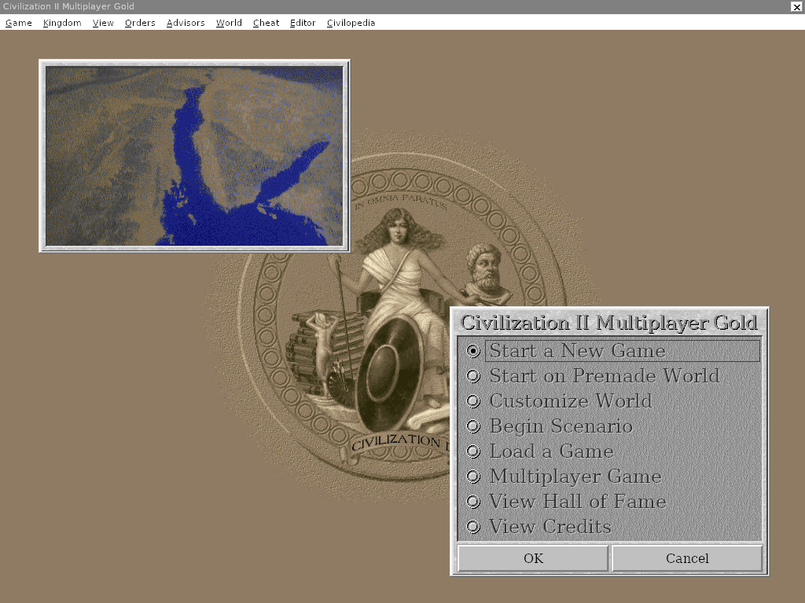
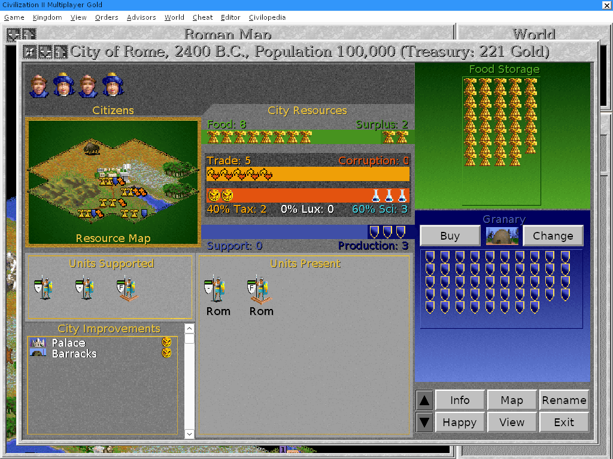
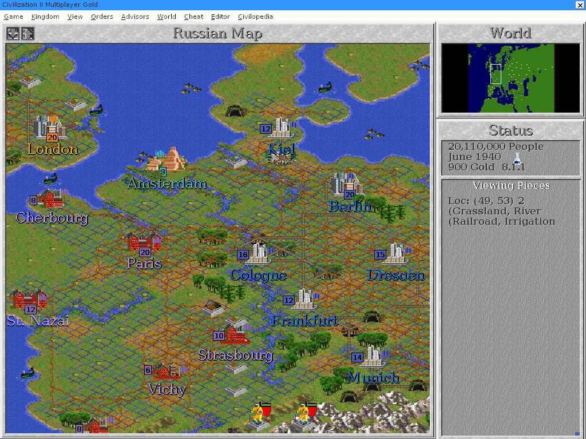
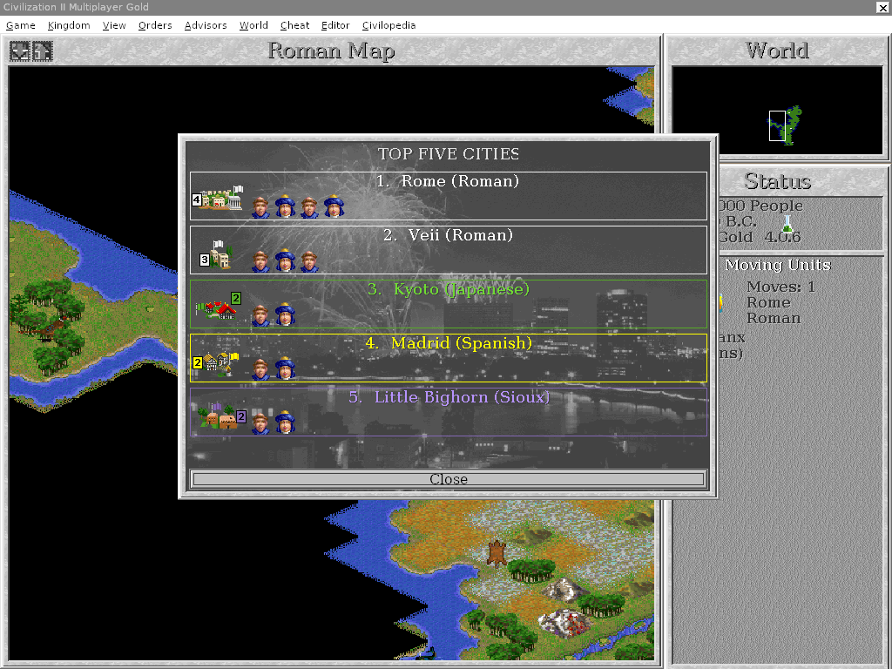
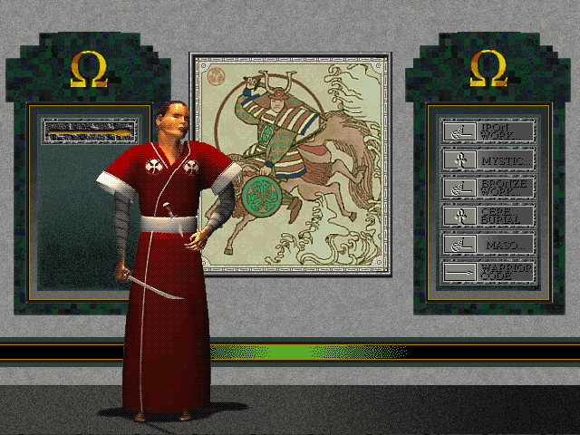
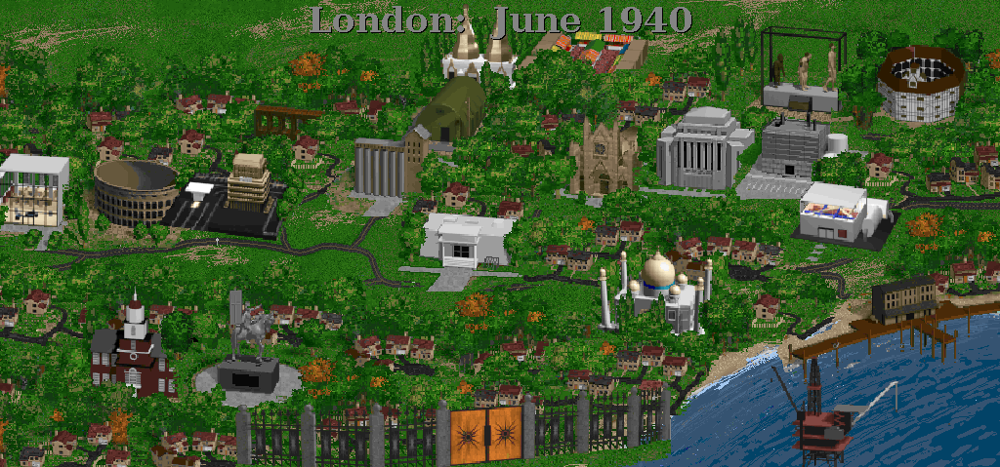

# OpenCiv2

Goal: reconstruct the source of *Sid Meier's Civilization II: Multiplayer Gold Edition*
(1998) as portable C++ that builds and runs natively on Linux, macOS and Windows,
and prove it behaves exactly like the original binary: the same screens, pixel for pixel,
and the same random numbers, call for call, on recorded games.

## Layout

| Path | What |
| --- | --- |
| `src/auto/` | The game: decompiled once, now C++ edited directly, a file per subject (`city.cpp`, `unit.cpp`, `ai.cpp`, `diplomacy.cpp`, `map.cpp`, `window.cpp` …). |
| `src/game/` | Functions the decompiler could not translate, reconstructed by hand. |
| `src/data/` | The game's static data (`gamedata.h`/`.cpp`), laid out exactly as in the original. |
| `src/include/` | Types recovered from the binary: units, cities, civilizations, map, the game's classes. |
| `src/platform/` | The Windows API the game uses (windows, GDI, controls, files, sound, video) implemented in portable C. |
| `src/host/` | What the platform layer needs from the machine: window, input and audio over SDL2; the portable build's runtime. |
| `src/native/` | The C runtime pieces the native builds need. |
| `data/` | Fonts as the original renders them, and the original executable's data sections. |
| `re/` | Analysis results: function list, calling conventions, data layout, Ghidra's decompilation. |
| `harness/` | The replay scripts and the comparison with the original (`run.py`, `compare.py`, `native_suite.sh`). |
| `hook/` | An `XDaemon.dll` proxy that makes the original deterministic under Wine. |
| `tools/` | Build, analysis and refactoring scripts. |
| `docs/`, `STATUS.md` | Notes on the reconstruction and its verification. |

## Approach

1. **Inventory**: Ghidra decompiles all ~4,900 functions; names and types for every function,
   global, class and field were recovered from their use.
2. **Translation**: the decompiled code was turned into C that compiles natively, then edited
   by hand: names, types, struct access, real locals, data as ordinary variables. It is now C++
   (`docs/hand-reconstruction.md`).
3. **Platform**: the game keeps calling the Windows API; `src/platform` implements the part it
   uses on top of SDL2, so the same game code runs everywhere.
4. **Determinism**: under Wine, the `hook/` proxy DLL pins the original's random seed, gives it a
   virtual clock and replays recorded input. The native builds do the same, so a recorded
   scenario plays identically in both.
5. **Differential harness**: each scenario in `harness/scripts` (new game, turns, cities,
   diplomacy, editors, 50 turns of play …) is recorded from the original once; the native builds
   replay it and must produce the same screenshots and the same sequence of `rand()` calls.
   Changes to the code are also checked function by function against the previous version's
   machine code (`tools/cxx_compare.py`), which covers the code no scenario reaches.

## Download and play

The game files are not included: you need your own copy of Civilization II Multiplayer
Gold Edition, installed or on its CD. Each download, built from the latest commit, is one
program that finds the game where it is usually installed, or its CD (or a copy of it) in
a drive, else asks where it is, and copies it into a `GameData` folder (from the CD:
unpacked from the installer's cabinet, with the videos); afterwards it starts the game
directly. `--setup [FOLDER]` sets the game up again (from FOLDER: the installed game or
the CD); `FOLDER` plays the game in FOLDER where it is.

- **Windows:** [OpenCiv2-windows.zip](https://github.com/richardpenman/civ2/releases/download/latest/OpenCiv2-windows.zip):
  `OpenCiv2.exe`. Put it in any folder and double-click it; `GameData` is beside it. It runs
  full screen with the menu bar shown (`CIV2_WINDOW=1`: in a window).
- **macOS** (11 or later, Apple silicon or Intel):
  [OpenCiv2-macos.zip](https://github.com/richardpenman/civ2/releases/download/latest/OpenCiv2-macos.zip):
  `OpenCiv2.app`. It is not signed by a registered Apple developer, so macOS refuses it the
  first time: open System Settings > Privacy & Security and click "Open Anyway". `GameData`
  is in `~/Library/Application Support/OpenCiv2`; the game is also found in a Wine or
  CrossOver drive C:.
- **Linux** (x86-64):
  [OpenCiv2-linux-x86_64.tar.gz](https://github.com/richardpenman/civ2/releases/download/latest/OpenCiv2-linux-x86_64.tar.gz):
  unpack it and run `OpenCiv2/OpenCiv2` (SDL2 is built in). `GameData` is in
  `~/.local/share/OpenCiv2`; the game is also found in Wine's drive C:, and asked for with
  `zenity` or `kdialog` where there is one.

Music: the CD's music is audio tracks, which the set-up does not copy; `tools/extract_disc.py`
copies it from a disc image.

## Build and run

To build it yourself, install your copy of Civilization II in `~/Civ2` (the directory with
`civ2.exe`, `Tiles.dll`, the `.TXT` files …), or point `CIV2_GAME` at it.

### macOS

```sh
xcode-select --install          # C/C++ compiler
brew install sdl2
pip3 install pefile

git clone https://github.com/richardpenman/civ2 && cd civ2
python3 tools/build_port.py     # -> build/OpenCiv2  (several minutes; the first time it
                                #    downloads wasi-sdk, wabt, unshield, zlib into tools/toolchain)
tools/run-civ2.sh               # plays the game in ~/Civ2
```

### Linux

As on macOS, with `libsdl2-dev` and `python3-pefile` from the package manager:

```sh
git clone https://github.com/richardpenman/civ2 && cd civ2
python3 tools/build_port.py     # -> build/OpenCiv2
tools/run-civ2.sh
```

### Windows

In an [MSYS2](https://www.msys2.org) **MINGW64** shell:

```sh
pacman -S git mingw-w64-x86_64-gcc mingw-w64-x86_64-SDL2 mingw-w64-x86_64-python mingw-w64-x86_64-python-pefile
git clone https://github.com/richardpenman/civ2 && cd civ2
python3 tools/build_port.py     # -> build/OpenCiv2.exe and SDL2.dll
```

Then play from a normal Command Prompt (or double-click) with `tools\run-civ2.bat [GAMEDIR]`;
the game is looked for in `%USERPROFILE%\Civ2` by default.

The Windows executable can also be cross-compiled on Linux: `python3 tools/build_port.py module c
exe-windows` (it also downloads SDL2's MinGW release):
`build/OpenCiv2.exe`, the one file the release has (SDL2 and the fonts built in).

## Tooling

Development runs in Docker on Linux; `tools/dk CMD` runs a command in the dev container with
the repository at `/work` and the game at `/civ2`.

| Tool | Notes |
| --- | --- |
| Docker images (`make images`) | Wine (runs the original), MinGW, g++/gcc with 32-bit support, SDL2, Python; Ghidra for the analysis. |
| wasi-sdk + wabt (`tools/fetch-toolchain.sh`) | The portable build: the game compiles to a wasm32 module (keeping the original's 32-bit data model), which wasm2c turns into C for any machine. |
| `hook/` (`make hook`) | The proxy DLL that makes the original replayable. |

```sh
make native          # build/civ2-linux32: gcc -m32, the same code, easier to debug
make port            # build/OpenCiv2: the portable build
make ref SCRIPT=harness/scripts/turns.txt    # record the original on a scenario
make native-suite    # replay every scenario on a native build and compare (EXE=OpenCiv2, OpenCiv2.exe under Wine)
```

## Status

Playable. Every function of the game that can run has source; the only parts not reconstructed
are the original's MSVC runtime (replaced by the platform's C library) and unreachable 16-bit
leftovers. 25 of the 29 recorded scenarios match the original exactly; the other four differ in
a few pixels of an editor dialog, a Civilopedia page and the power graph. The scenarios run about
two thirds of the game's functions; multiplayer, the High Council and some editor dialogs are not
covered yet.

The code is being modernized step by step, each step checked by the harness: it compiles as
strict C++ and keeps the original's data layout; recovering the remaining types, classes,
structured control flow and smaller functions is in progress. Details in `STATUS.md`.

| | |
| --- | --- |
|  |  |
|  |  |
|  |  |

*The native build: the main menu, a city, the World War II scenario, the Top Five Cities, a foreign
leader receiving an envoy and London's city view with its wonders.*
